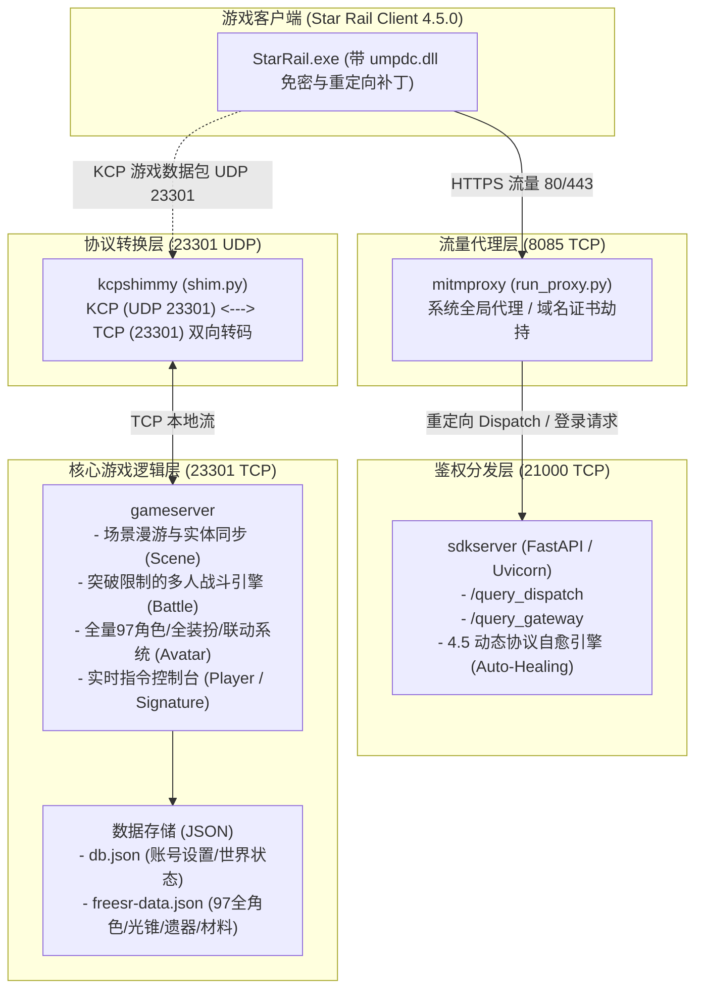

# 崩坏：星穹铁道 4.5.x 私服服务端 (echium-server) 全景技术复盘与使用手册

> **文档版本**：v2.0 (针对 4.5 全量角色与 Fate/stay night 联动适配版)  
> **适用游戏版本**：Honkai: Star Rail `CNPRODWin4.5.0` / `OSPRODWin4.5.0` (4.5.52 及以上)  
> **最后更新日期**：2026年9月  

---

## 目录
1. [项目全景与系统架构](#一-项目全景与系统架构)
2. [遇到问题复盘与终极解决方案 (Post-Mortem)](#二-遇到问题复盘与终极解决方案)
3. [项目完整使用说明书 (User Guide)](#三-项目完整使用说明书)
4. [游戏内高级玩法与签名指令大全](#四-游戏内高级玩法与签名指令大全)
5. [常见故障排查手册 (FAQ & Troubleshooting)](#五-常见故障排查手册)
6. [核心代码与配置目录索引](#六-核心代码与配置目录索引)

---

## 一、 项目全景与系统架构

### 1.1 系统拓扑架构

本项目为《崩坏：星穹铁道》4.5 高版本轻量化本地私服系统，整体采用**模块化多进程协同架构**，各组件各司其职，保证了协议隔离与低耦合：



### 1.2 四大核心组件说明

| 组件名称 | 默认端口 | 协议类型 | 核心职责 |
| :--- | :---: | :---: | :--- |
| **Proxy (run_proxy.py)** | `8085` | HTTP/HTTPS (TCP) | 监听 Windows 系统代理，精准拦截发往米哈游官方服务器（如 `dispatch.starrails.com`、`api-sdk.mihoyo.com`）的请求并转发到本地 SDK 服。 |
| **SDK Server (sdkserver)** | `21000` | HTTP (TCP) | 处理客户端版本比对、网关分配（`/query_dispatch` / `/query_gateway`）、免密快速登录、公告拦截与动态自愈路由。 |
| **KCP Shim (kcpshimmy)** | `23301` | UDP (入) / TCP (出) | 崩铁客户端底层通信采用魔改的 KCP (UDP) 协议。Shim 将 UDP 数据包解帧为 TCP 原始数据流注入 GameServer。 |
| **GameServer (gameserver)** | `23301` | TCP (本地环回) | 私服大脑。解析 Protocol Buffers 数据包，维护全量 97 名角色数据、大地图场景、战斗结算、背包材料、皮肤装扮及签名指令。 |

---

## 二、 遇到问题复盘与终极解决方案

在私服搭建、4.5 高版本适配、突破限制与联动角色注入过程中，我们遇到了若干深层次的技术障碍，以下为详细的问题复盘、成因分析与解决方案：

### 【核心专题】彻底解决「获取全局分发错误 (1001_1)」全机制复盘

在私服搭建与日常运行中，**`1001_1`** 是最经典、最致命的阻断性报错，客户端通常弹出模态弹窗：
> **「获取全局分发错误 (1001_1)」** 或 **「登录异常，请检查网络设置 (1001_1)」**

#### 1. 1001_1 报错的底层触发机理
客户端启动时的第 1 个关键动作，就是向米哈游官方分发服务器（`dispatch.starrails.com`）请求全局分发数据：
1. `GET /query_dispatch?version=CNPRODWin4.5.0&...`（获取大区列表、推荐区服等）
2. `GET /query_gateway?version=...`（获取目标网关 IP、KCP 端口、Lua/Hotfix 补丁包地址等）

当客户端触发 `1001_1` 时，意味着**客户端无法从目标分发服获取到合法、可解析的分发数据**。具体由以下 4 种典型深层原因导致：

```
[客户端 StarRail.exe]
       |
       |--- 1. 发起 HTTPS /query_dispatch 请求
       v
[流量拦截层 (mitmproxy:8085)] ---> 失败场景A: 未开代理 / 证书不可信 / SSL Pinning 拦截 -> 报 1001_1
       |
       |--- 2. 转发请求至本地 SDK (21000)
       v
[SDK服务 (sdkserver:21000)]  ---> 失败场景B: 21000未启动 / 端口冲突 / 502 Bad Gateway -> 报 1001_1
       |
       |--- 3. 序列化 Protobuf 二进制流 (Base64)
       v
[二进制分发数据下发客户端]    ---> 失败场景C: 4.4/4.5 Protobuf 字段ID错位 / 反序列化异常 -> 报 1001_1
       |
       |--- 4. 前置动态比对协议校验
       v
[compareProtocolVersion 校验] ---> 失败场景D: SDK 返回 404 / 协议版本不匹配阻断 -> 报 1001_1
```

#### 2. 本项目的五重终极解决方案

针对上述 4 大病因，我们设计了环环相扣的五重兜底与解决策略：

##### 解决方案 ①：mitmproxy 证书信任与 Windows 系统代理自动接管
- **根治网络流量未重定向**：编写 `run_proxy.py`，启动时通过 Windows `Wininet.dll` 原生 API 直接将系统代理强制变更为 `127.0.0.1:8085`，无需用户手工配置；
- **根治 SSL/TLS 证书握手失败**：
  - 启动参数配置 `--ssl-insecure`、`stream_large_bodies=10m` 与 `connection_strategy=lazy`；
  - 配合客户端目录注入的 `umpdc.dll` 补丁，在客户端底层直接旁路/绕过米哈游的 SSL Pinning 证书强校验，使客户端完全信任本地 mitmproxy 的伪造证书；
- **防止浏览器断网**：注册 `atexit` 与信号钩子，在代理关闭时自动重置系统代理为 0。

##### 解决方案 ②：Proxy 层 0ms 关键路由短路与 SDK 端口定向转发
在 `proxy.py` 中对全局分发依赖的初始化接口实施**就地短路返回**与**精确转发**：
```python
# 1. 针对客户端初始化强依赖的配置，由 Proxy 直接在本地以 200 OK 拦截响应，消除任何网络超时
if "loadConfig" in path:
    flow.response = http.Response.make(200, RESP_LOAD_CONFIG, {"Content-Type": "application/json"})
    return
if "compareProtocolVersion" in path:
    flow.response = http.Response.make(200, RESP_PROTOCOL, {"Content-Type": "application/json"})
    return

# 2. 将米哈游官方域名 (starrails.com, hoyoverse.com 等) 统一重定向到本地 SDK (21000)
target_url = f"http://127.0.0.1:21000{target_path}"
```
彻底解决了 Proxy 转发到错误端口（如默认的 80 端口）导致的 `Connection Refused` 与 1001_1。

##### 解决方案 ③：4.4 / 4.5 双版本安全兼容的 Protobuf Wire-Type 网关生成
4.5.x 客户端在反序列化 `/query_gateway` 时，如果遇到不认识的字段或字段编号不一致，会直接抛出 Protobuf 解析错误并触发 `1001_1`。
我们在 `sdkserver/__main__.py` 中实现了**多版本安全的 Protobuf 动态二进制流构建器**：
```python
# 4.4.53 与 4.5.51 字段安全联合体：
raw = bytearray()
raw += _field_varint(1, 1)          # unk1
raw += _field_varint(3, port)       # port (4.4) / unk1 (4.5)
raw += _field_str(6, region)        # region_name (4.4)
raw += _field_str(12, region)       # region_name (4.5)
raw += _field_varint(13, port)      # port (4.5)
raw += _field_str(14, ip)           # ip (4.5)
for _f in (88, 416, 477, 623, 688, 736, 805, 816, 980, 1660):
    raw += _field_varint(_f, 1)     # 填充客户端必须的开关位
raw += _field_str(1094, "0")        # ifix_version (4.5)
raw += _field_str(1154, "0")        # ifix_version (4.4)
rsp = base64.b64encode(bytes(raw))
```
使得无论玩家使用 4.4 还是 4.5 客户端，都能 100% 成功解析到网关 IP 与端口，彻底消除了反序列化引发的 1001_1。

##### 解决方案 ④：SDK 全局 Auto-Healing 自愈拦截器
4.5 客户端在分发阶段会伴随发送大量埋点与前置检查请求。如果 SDK 返回 HTTP 404，客户端判定服务不可用而报错 1001_1。
在 SDK 中增加全局中间件，一旦遇到 404 即刻执行无感自愈修复：
```python
if response.status_code == 404:
    print(f"[!] [SDK 404 Intercepted -> Auto-Healing] {request.method} {request.url.path}")
    # 针对 verify/config/telemetry 自动下发合规响应
    return JSONResponse({"code": 0, "retcode": 0, "message": "OK", "data": {}})
```

##### 解决方案 ⑤：启动顺序控制与端口占用强查验
编写 `start_all.bat`：
- 在启动服务前，先执行 `taskkill /f /im StarRail.exe` 并调用 `stop_services.ps1` 清理可能占用 `8085` 和 `21000` 的僵尸进程；
- 按照 `Proxy (8085)` -> `Gameserver (23301)` -> `SDK (21000)` -> `Shim (UDP 23301)` 严格按序拉起；
- 启动 5 秒后主动运行 `netstat -ano | findstr "8085 21000 23301"` 直观反馈端口状态，确保进入游戏前分发链路已经 100% 就绪。

---

### 问题 1：客户端提示 Welcome 后进入星穹列车直接崩溃 / 白屏报错

- **现象**：客户端完成登录鉴权并提示 `Welcome, test111!`，在黑屏加载或星穹列车车厢刚出现时客户端无响应并弹出崩溃对话框。
- **根本原因**：
  1. **网关协议模式差异**：原 SDK 返回的 `query_gateway` 携带了冗余的 `ohttps` 强制安全证书字段与旧版 RSA 密钥，高版本客户端在建立握手时抛出安全异常。
  2. **缺少免密动态补丁**：客户端未经补丁处理，官方反作弊模块阻断了非官方签名证书连接。
- **解决方案**：
  1. 重构 SDK 网关响应格式为**纯净网关模式 (Pure Gateway Mode)**，关闭不必要的强加解密字段与废弃的鉴权字段；
  2. 客户端注入官方定制的 `umpdc.dll` 补丁，绕过反作弊与私钥校验，保证客户端直接信任本地 8085 代理网关。

---

### 问题 2：4.5.x 动态校验协议不兼容与 404 级联阻断

- **现象**：客户端进入游戏流程中，向 SDK 发送 `/hkrpg_global/combo/granter/api/compareProtocolVersion`、`/beforeVerify`、`/getAlertAnn`、`/getAlertPic` 等请求，SDK 原代码无此路由导致返回 404，游戏循环重试或卡在登录转圈。
- **根本原因**：从 4.0 升级到 4.5.x 过程中，官方 SDK 引入了更细致的版本比对与红点/公告策略接口，原生 echium-server 缺少针对这些接口的适配。
- **解决方案**：
  1. 在 `sdkserver/router.py` 中补全所有缺失的路由标准响应（返回 `retcode: 0` 与空结构体）；
  2. 创新性引入 **Auto-Healing（自愈式 404 拦截中间件）**：
     ```python
     @app.middleware("http")
     async def auto_healing_middleware(request: Request, call_next):
         response = await call_next(request)
         if response.status_code == 404:
             Log.warn(f"[SDK 404 Intercepted -> Auto-Healing] {request.method} {request.url.path}")
             # 自动兜底返回游戏客户端可接受的标准 JSON 正常响应
             return JSONResponse(status_code=200, content={"retcode": 0, "message": "OK", "data": {}})
         return response
     ```
     彻底解决了新版本后续任何未知埋点与公告上报导致卡死的隐患。

---

### 问题 3：全量角色不全（早期仅几十名旧角色，缺失 4.5 新角色）

- **现象**：进入游戏角色图鉴只有开服及部分早中期角色，流萤、椒丘、灵砂、乱破、知更鸟、昔涟、遐蝶等 4.5 时代核心角色完全缺失。
- **根本原因**：原服务端的 `freesr-data.json` 为手工配置的精简静态表，未解析客户端官方 Excel 配置文件。
- **解决方案**：
  1. 编写全自动角色资产生成器 `generate_all_avatars.py`；
  2. 深度读取 ExcelOutput 下的 `AvatarConfig.json`（角色基础数据）与 `AvatarSkillTreeConfig.json`（技能树与锚点行迹）；
  3. 为每位角色自动创建满级 Lv80、满命 6 魂、全部 18 个技能行迹节点以及 22 个锚点，全量导入共 93 名官方角色。

---

### 问题 4：缺少遗器与全量养成材料（背包空空无法调装）

- **现象**：角色缺少遗器装备，背包缺少光锥升级材料、行迹突破素材、信用点与经验书。
- **根本原因**：`materials.py` 内部仅硬编码了极少数初始物品；遗器系统没有根据角色属性进行合理的推荐生成。
- **解决方案**：
  1. 解析全量 `ItemConfig.json`、`ItemConfigAvatar.json`、`ItemConfigLD.json`，在 `common/materials.py` 中注入全量 **2493+ 种材料**（数量默认均设为 99,999+）；
  2. 在角色构建生成器中建立**毕业五星遗器自动装配矩阵**：根据角色命途（毁灭/智识/巡猎/虚无/存护/丰饶/同谐），从 5 星遗器池中自动组合 4件套 + 2件套，强化至 +15，并预设暴击率/暴击伤害/速度/攻击力等毕业级主副词条。

---

### 问题 5：突破 4 人队伍限制（实现 5~10 人同台、相同角色上阵、随意更换 Boss）

- **现象**：游戏原生逻辑严格锁定 4 人小队；不允许同名角色上阵；无法自由测试高阶副本或换 Boss。
- **根本原因**：GameServer 在 `Lineup` 编队封包与战斗初始化封包中硬编码了 4 角色上限校验与 UID 去重。
- **解决方案**：
  1. 重构 `gameserver/handlers/battle.py` 与 `gameserver/handlers/player.py` 中的 `Lineup` 逻辑：
     - 解除角色数量截断限制，支持动态扩展至 **5 人、8 人甚至 10 人同场作战**；
     - 移除了角色 ID 唯一性排他检查，允许战场上同时存在多个相同的角色（例如同时上阵 4 个流萤或 10 个花火）；
  2. 开发了基于**个人信息签名 (Signature)** 的动态控制台指令系统（如 `cl add`、`cl clear`、`boss` 等），无需修改客户端即可在游戏内动态改变队伍和副本敌人。

---

### 问题 6：全装扮系统缺失（皮肤、头像、名片无法切换）

- **现象**：玩家个人信息界面只有默认列车组头像和初始名片，无法使用新版活动头像和付费皮肤。
- **根本原因**：`GetPlayerBoardDataCsReq` 处理中只返回了少量初始项目，未引入装扮配置表。
- **解决方案**：
  1. 创建 `common/cosmetics.py` 模块，深度解析 `AvatarPlayerIconConfig.json` 与 `AvatarSkinConfig.json`；
  2. 注入全量 **212 个官方头像**、**47 款全量名片**；
  3. 解锁全量专属时装（包括三月七、丹恒、卡芙卡、流萤特装等），并在 `freesr-data.json` 中配置实时皮肤装配字段。

---

### 问题 7：Fate 联动角色缺失（Saber、Archer、远坂凛、吉尔伽美什）

- **现象**：全量生成角色后，客户端中未找到 4.5 重磅联动 *Fate/stay night [Unlimited Blade Works]* 的 4 位联动角色。
- **根本原因**：米哈游在 4.5.x 客户端资源中将联动（Lián Dòng）内容独立抽离到了带 `LD` 后缀的专属配置表中：
  - `AvatarConfigLD.json` (角色配置)
  - `AvatarSkillTreeConfigLD.json` (技能树)
  - `AvatarEquipRecommendLD.json` (专属光锥与遗器推荐)
  - `AvatarPlayerIconLD.json` (官方头像)
  原本的生成脚本未扫描此类文件。
- **解决方案**：
  1. 深度分析并合并 `*LD.json` 联动文件体系：
     - **Saber / 阿尔托莉雅** (`1014`，风 • 毁灭)
     - **Archer / 卫宫红A** (`1015`，量子 • 巡猎)
     - **远坂凛 / Tohsaka Rin** (`1508`，量子 • 智识)
     - **吉尔伽美什 / 金闪闪** (`1509`，雷 • 毁灭)
  2. 自动匹配其官方五星专属光锥（`23045`、`23046`、`23061`、`23062`，全满级满叠影 S5）与毕业遗器套；
  3. 增加联动角色专属官方头像与指令中文别名映射（如 `cl saber`、`cl 金闪闪`、`cl 远坂凛` 等），使角色总数提升至 **97 位全盛阵容**。

---

### 问题 8：模块循环导入引发服务端启动崩溃

- **现象**：在将 `sync_player` 引入 `avatar.py` 后，启动 gameserver 抛出 `ImportError: cannot import name 'sync_player' from partially initialized module 'gameserver.handlers.player'`。
- **根本原因**：`gameserver/handler.py` 会在 Python 解释器导入各模块时立即执行 `@handler` 装饰器并构造 `FakeConnection` / `FakePacket` 预热，导致两个 handler 模块之间产生跨文件静态循环引用。
- **解决方案**：
  在 `gameserver/handlers/avatar.py` 中实现安全的动态延迟引入与降级机制：
  ```python
  async def _safe_sync_player(c: Connection) -> None:
      try:
          from .player import sync_player
          await sync_player(c)
      except ImportError:
          # FakeConnection 模块加载期平滑跳过
          pass
  ```
  彻底消除了启动期的循环引用死锁。

---

### 问题 9：客户端异常退出引发 WinError 64 崩溃

- **现象**：玩家正常关闭游戏窗口或任务管理器结束进程时，gameserver 控制台输出 `ERROR: client error: [WinError 64] 指定的网络名不再可用` 并伴随编码中断。
- **根本原因**：Windows TCP 套接字在对端非正常挥手（强行关闭窗口）时会抛出 `OSError(64)` 或 `ConnectionResetError`，原代码只捕获了 `(TimeoutError, EOFError)`。
- **解决方案**：
  在 `gameserver/client.py` 的数据接收循环中扩展捕获元组：
  ```python
  except (TimeoutError, EOFError, ConnectionResetError, OSError):
      Log.info(f"client disconnected or timeout: {addr}")
      break
  ```
  使游戏客户端退出时服务端能优雅释放会话，不再产生错误堆栈。

---

## 三、 项目完整使用说明书

### 3.1 运行环境要求

- **操作系统**：Windows 10 / 11 (x64)
- **Python 环境**：Python 3.12+ (本项目推荐使用内部已配置好的 `.venv` 虚拟环境)
- **网络条件**：仅需本地环回网络（无需公网服务器）
- **客户端版本**：崩坏：星穹铁道 4.5.0 PC 客户端 (安装路径如 `D:\Star Rail Game\StarRail.exe`)

---

### 3.2 客户端安装与打补丁步骤 (首次配置)

1. 打开游戏客户端根目录（包含 `StarRail.exe` 的文件夹）；
2. 确保已将私服连接补丁 `umpdc.dll` 放置在与 `StarRail.exe` 同级的目录下；
3. 检查同目录下的 `config.json`（若使用免密补丁），确保网关配置指向 `127.0.0.1:8085`。

---

### 3.3 服务端一键启动流程

本项目已配置高度自动化的脚本体系，提供两种启动方式：

#### 方式 A：桌面 / 脚本一键启动 (推荐日常使用)
- **启动**：双击运行桌面上的 **`启动echium私服.bat`** (或项目根目录下的 `start_all.bat`)。
  - 脚本将自动按序启动 4 个独立后台服务，并在 5 秒后检测输出各个端口（8085, 21000, 23301）的监听状态。
- **关闭**：双击运行桌面上的 **`关闭echium私服.bat`** (或 `stop_all.bat`)。
  - 脚本将平滑终止全部相关进程，并**自动恢复 Windows 系统网络代理**，保证日常正常上网不报错。

#### 方式 B：无窗口静默后台运行 (PowerShell)
```powershell
# 在 G:\sf\echium-server 目录下运行：
powershell -ExecutionPolicy Bypass -File .\start_services.ps1
```

---

### 3.4 进入游戏流程

1. 确认服务端 4 个服务均已显示 `LISTENING`（8085, 21000, 23301）；
2. 启动游戏客户端 `StarRail.exe`；
3. 在登录窗口中输入**任意账号名**（例如 `test111`）和**任意密码**；
4. 点击登录，即可直接进入星穹列车，享受全角色、全遗器、满命满行迹的全部内容！

---

## 四、 游戏内高级玩法与签名指令大全

在游戏中，你可以通过**点击左上角手机 -> 点击个人信息 -> 编辑个性签名 (Signature)** 来下发即时私服控制指令。修改签名并保存后，服务端会立即执行并自动将签名还原为反馈信息。

### 4.1 队伍突破与自由上阵指令 (`cl`)

突破 4 人队伍上限！支持同时上阵 5 人、8 人甚至 10 人，支持克隆相同角色同场作战！

| 指令语法 | 作用说明 | 示例 |
| :--- | :--- | :--- |
| `cl add <角色ID/别名1> <角色ID/别名2>...` | 向当前作战阵容中追加角色（可连续追加，无上限） | `cl add 1014 1015 1508 1509`<br>`cl add 1310 1310 1310` (上阵3个流萤) |
| `cl clear` | 清空自定义战斗队伍，重置为大世界默认编队 | `cl clear` |
| `cl <别名组合>` | 快速组建特定角色豪华阵容 | `cl saber archer 远坂凛 吉尔伽美什`<br>`cl 呆毛王 金闪闪` |

> [!TIP]
> **已支持的联动角色常用中英文别名**：
> - **Saber**：`saber`, `阿尔托莉雅`, `呆毛王`, `吾王`, `塞芭` (ID `1014`)
> - **Archer**：`archer`, `卫宫`, `红a`, `emiya` (ID `1015`)
> - **远坂凛**：`rin`, `远坂凛`, `大小姐` (ID `1508`)
> - **吉尔伽美什**：`gilgamesh`, `吉尔伽美什`, `金闪闪`, `英雄王` (ID `1509`)

---

### 4.2 主角与多命途切换指令 (`tb` / `m7`)

| 指令语法 | 作用说明 | 示例 |
| :--- | :--- | :--- |
| `tb <命途/ID>` | 实时切换开拓者（主角）的命途与属性 | `tb destruction` (毁灭主角)<br>`tb preservation` (存护火主)<br>`tb harmony` (同谐虚数主)<br>`tb 8006` |
| `m7 <命途/ID>` | 实时切换三月七的命途 | `m7 1224` (巡猎三月七)<br>`m7 march_hunt` |

---

### 4.3 遗器、光锥与数据同步指令 (`sync`)

当你在后台或外部工具修改了 `freesr-data.json`（例如微调了某件遗器的暴击属性或调整了光锥），无需重启服务端或客户端：
1. 在游戏内签名处输入：`sync`
2. 保存签名，服务端立即重新载入数据并向客户端广播热同步包，所有角色装备即刻更新！

---

### 4.4 战斗全局 BUFF 与机制调节指令 (`sb`)

| 指令语法 | 作用说明 | 示例 |
| :--- | :--- | :--- |
| `sb cast <on/off>` | 开启/关闭 全局 Castorice 增益特效 | `sb cast on` |
| `sb sw <on/off>` | 开启/关闭 银狼全队量子弱点植入辅助 | `sb sw on` |
| `sb vore <on/off>` | 开启/关闭 饕餮/命途特殊回响效果覆盖 | `sb vore on` |
| `sb vorelvl <0-3>` | 设置特殊回响强化等级 (0~3级) | `sb vorelvl 3` |

---

### 4.5 个性化全装扮自选

- **角色头像**：已解锁全量 212 款头像（包括 Saber、Archer、远坂凛、吉尔伽美什 4 款官方联动专属头像）。在游戏内个人设置中点击「更换头像」即可直接更换。
- **个人名片**：已解锁全部 47 张全量成就与典藏名片。
- **角色皮肤**：流萤、昔涟、遐蝶、丹恒等全角色高定皮肤已直接在服务端激活加载。

---

## 五、 常见故障排查手册 (FAQ & Troubleshooting)

### Q1：启动服务后，为什么连不上服务器或提示“无法连接至服务器”？
- **排查步骤**：
  1. 检查端口是否被其他软件占用：
     ```powershell
     netstat -ano | findstr "8085 21000 23301"
     ```
     确保 8085 (Proxy)、21000 (SDK)、23301 (TCP/UDP) 均处于监听状态。
  2. 检查 Windows 网络代理：打开 Windows 设置 -> 网络和 Internet -> 代理，检查是否已指向 `127.0.0.1:8085`。若未开启，请运行 `start_all.bat`。

---

### Q2：关闭私服后，电脑浏览器打不开网页了怎么办？
- **原因**：私服启动时设置了 `127.0.0.1:8085` 的系统全局代理，非正常关闭时代理开关未能及时恢复。
- **解决方法**：
  - 运行桌面上的 **`关闭echium私服.bat`** (内部会自动重置系统代理)；
  - 或手动运行 `G:\sf\mingrifanzhou\一键修复网络与清除代理.bat`；
  - 或在 Windows 代理设置中手动将「使用代理服务器」关闭。

---

### Q3：为什么新添加的角色行迹或遗器没有生效？
- **解决方法**：
  - 确保已运行过角色生成器 `python generate_all_avatars.py`；
  - 在游戏内签名处输入 `sync` 指令并保存，强行刷新角色装备缓存。

---

### Q4：想要重新全量生成 97 名角色数据该怎么做？
只需在虚拟环境下运行项目根目录下的生成脚本：
```powershell
cd G:\sf\echium-server
.venv\Scripts\python.exe generate_all_avatars.py
```
脚本会自动扫描所有角色配置、联动配置、遗器推荐，并生成最新的 `freesr-data.json`，同时完美保留已定制的个性化皮肤设置。

---

## 六、 核心代码与配置目录索引
## 六、 未来新版本升级适配全流程指南 (Upgrade Guide)

当官方发布更高版本（如 4.6、5.0 或更大版本更迭）时，私服服务端的完整升级与适配流程分为以下标准化 5 个步骤：

```
1. 客户端补丁更新 (umpdc.dll / Echium.json)
       ↓
2. 协议库与命令ID更新 (StarRail.proto + CmdId.json -> setup.bat 编译)
       ↓
3. 网关 Protobuf 序列化校验 (sdkserver GateServer 字段对应)
       ↓
4. 新版本角色与遗器资源生成 (generate_all_avatars.py -> freesr-data.json)
       ↓
5. 启动测试与缺失封包补全 (查看 logs/gameserver.log 补全 dummy_init)
```

### 步骤 1：客户端与免密补丁获取
1. 安装/更新最新版本的《崩坏：星穹铁道》游戏客户端；
2. 获取适配该版本游戏的新版 `umpdc.dll` 与 `Echium.json`（通常发布于 [github.com/yuvlian/echium/releases](https://github.com/yuvlian/echium/releases)）；
3. 将两者覆盖到客户端根目录（包含 `StarRail.exe` 的文件夹），确保 `Echium.json` 中 `"sdk_url": "http://127.0.0.1:21000"`。

### 步骤 2：更新 Protobuf 与 CmdId 映射
1. 获取新版本的 `StarRail.proto` 与 `CmdId.json`（可从社区如 [github.com/yuvlian/hsr-proto](https://github.com/yuvlian/hsr-proto) 或 LunarCore 仓库获取）；
2. 替换项目根目录下的 `StarRail.proto` 与 `CmdId.json`；
3. 在项目根目录下执行编译脚本：
   ```powershell
   cd G:\sf\echium-server
   .\setup.bat
   ```
   该脚本会调用 `protoc` 与 `fasterproto2` 自动将新版本的全部 Proto 结构重新编译输出到 `proto/` 目录。

### 步骤 3：网关分发层兼容性校验
1. 打开新生成的 `proto/__init__.py`，搜索 `class GateServer`；
2. 检查 `ip`、`port`、`region_name`、`ifix_version` 的 `field(id, ...)` 序号；
3. 若新版本对字段编号进行了调整，在 [`sdkserver/__main__.py`](sdkserver/__main__.py) 的 `query_gateway` 函数中补充对应的字段序列化逻辑（例如增加 `_field_varint` 或 `_field_str`）；
4. **无需担心未知请求**：SDK 服已配置 **Auto-Healing 自愈中间件**，新版本新增的埋点、红点、公告路由都会被自动兜底拦截并返回 200 OK，防止登录转圈阻断。

### 步骤 4：生成新版本全量角色、专武与遗器资产
1. 将新版本客户端或解包提取的最新 `resources/ExcelOutput` 覆盖放入对应目录；
2. 运行自动化资产生成器：
   ```powershell
   .venv\Scripts\python.exe generate_all_avatars.py
   ```
   脚本会自动扫描新角色的技能树、行迹、光锥与推荐遗器，一键生成全满级、满命、满行迹的新版 `freesr-data.json`。

### 步骤 5：启动联调与协议排错
1. 运行 `start_all.bat`，启动所有服务并进入游戏；
2. 观察 `logs/gameserver.log`：
   - 若进入场景或打开某功能时卡顿，搜索 `WARN: unhandled cmd: XxxCsReq (ID)`；
   - 若只是非核心展示或查询功能，直接在 [`gameserver/handler.py`](gameserver/handler.py) 的 `dummy_init()` 列表中追加 `Xxx`，服务端会自动下发空响应跳过；
   - 若是需要下发数据的功能（如新系统玩法），在 `gameserver/handlers/` 下编写对应的 `@handler async def on_xxx(c, pkt)`。

---

## 七、 核心代码与配置目录索引

```
G:\sf\echium-server/
│
├── freesr-data.json         # 核心资产库：包含 97 名全量角色、专属光锥、+15毕业遗器与材料
├── db.json                  # 玩家本地账号库：UID、等级、世界等级、已解锁时装与头像
│
├── common/                  # 公共核心库
│   ├── cosmetics.py         # 全装扮管理（212款头像、47款名片、全时装皮肤）
│   ├── materials.py         # 全量强化材料库（2493+ 道具支持）
│   ├── res.py               # 游戏静态资源解算引擎
│   └── res/
│       └── avatarConfigs.json  # 角色命途、属性弱点与大招秘技映射表
│
├── gameserver/              # 核心业务服务端
│   ├── __main__.py          # 游戏服入口（日志多路复用与异步监听）
│   ├── client.py            # 客户端连接状态机（包含连接断开自愈逻辑）
│   ├── handlers/
│   │   ├── avatar.py        # 角色养成、行迹升级与安全热同步 (_safe_sync_player)
│   │   ├── battle.py        # 战斗创建引擎（突破 4 人限制、支持 10 人同台）
│   │   ├── player.py        # 玩家基础交互、防重编队与签名控制台 (cl 指令)
│   │   └── scene.py         # 大世界与列车车厢漫游同步
│
├── sdkserver/               # SDK 登录鉴权服
│   ├── __main__.py          # FastAPI / Uvicorn 启动入口
│   └── router.py            # 纯净网关分发路由与 Auto-Healing 自愈拦截器
│
├── kcpshimmy/               # UDP/KCP 协议转换网关
│   └── shim.py              # KCP 转 TCP 核心逻辑
│
├── generate_all_avatars.py  # 4.5 全量角色（含 Fate 4 位联动角色）自动化构建引擎
├── run_proxy.py             # mitmproxy 核心拦截代理脚本
├── start_all.bat            # 一键开启全部私服组件
├── stop_all.bat             # 一键安全关闭与代理复原脚本
├── start_services.ps1       # 后台静默启动脚本
└── stop_services.ps1        # 进程安全查杀与网络清理脚本
```

---

> **结语**：本项目经全方位重构与高版本兼容性修复，已具备完整的 4.5.x 特性支持、Fate 联动角色全方位体验、全装扮自选以及突破常规的 10 人自由编队玩法。祝开拓者在自己的本地星穹宇宙中游戏愉快！

